[lastro-financeiro](https://github.com/mateusalencarsantos738-dev/lastro-financeiro) ·
[CNN-CIFAR100-PyTorch](https://github.com/mateusalencarsantos738-dev/CNN-CIFAR100-PyTorch) ·
[python-fundamentals](https://github.com/mateusalencarsantos738-dev/python-fundamentals) ·
[java-fundamentals](https://github.com/mateusalencarsantos738-dev/java-fundamentals) ·
[c-fundamentals](https://github.com/mateusalencarsantos738-dev/c-fundamentals)

 

